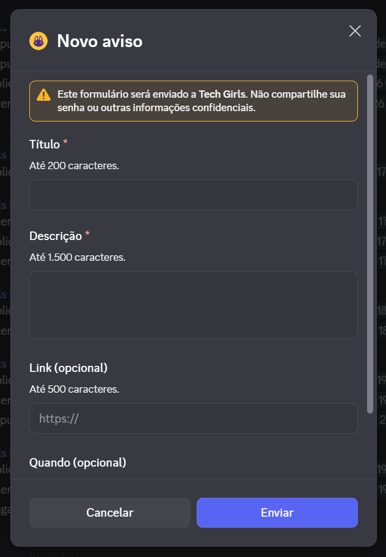
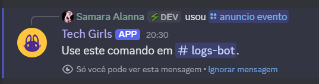
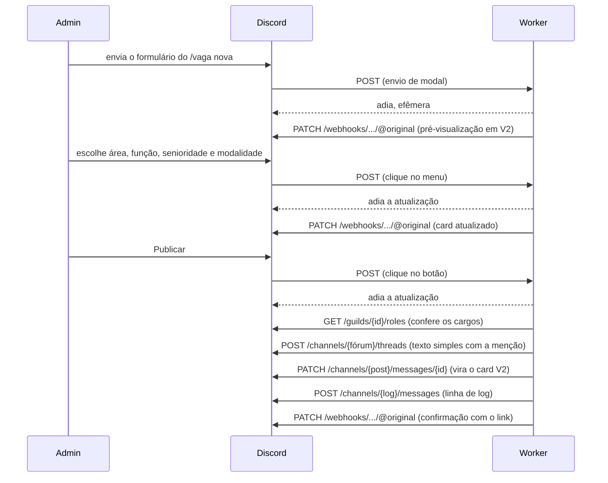

# Bot Tech Girls

Bot de Discord que publica **vagas** e **anúncios** no servidor da Tech Girls, comunidade de mulheres na tecnologia. Só as administradoras têm permissão para usar os comandos; para as membras, o bot aparece como autor dos posts e no conteúdo referencia a Administradora que efetuou as postagens.

Roda em Cloudflare Workers, no plano gratuito, sem processo ligado 24 horas, sem banco de dados e sem nenhuma dependência em tempo de execução.

Uma vaga publicada no fórum de vagas:


E um anúncio publicado no canal de avisos:


## Sumário

- [O que ele faz](#o-que-ele-faz)
- [Stack e por quê](#stack-e-por-quê)
- [Arquitetura](#arquitetura)
- [Decisões e aprendizados](#decisões-e-aprendizados)
  - [Components V2](#components-v2)
  - [Fórum e posts](#fórum-e-posts)
  - [Menções](#menções)
  - [Imagens](#imagens)
  - [Formulários](#formulários)
  - [Limites que definiram os campos](#limites-que-definiram-os-campos)
  - [Segurança e detalhes de API](#segurança-e-detalhes-de-api)
  - [Ainda não confirmado em teste real](#ainda-não-confirmado-em-teste-real)
- [Como rodar localmente](#como-rodar-localmente)
- [Deploy](#deploy)
- [Como assumir o bot](#como-assumir-o-bot)
- [Licença](#licença)

## O que ele faz

| Comando                                                  | O que faz                                                                                                                                                                                                                                                           |
| -------------------------------------------------------- | ------------------------------------------------------------------------------------------------------------------------------------------------------------------------------------------------------------------------------------------------------------------- |
| `/vaga nova`                                             | Abre um formulário (cargo, empresa, link, local, descrição) e mostra uma pré-visualização com menus de área, função, senioridade e modalidade. Ao publicar, cria um post no fórum de vagas com as tags certas e menciona o cargo da área e, se houver, o da função. |
| `/vaga encerrar`                                         | Dentro do post de uma vaga: aplica a tag Encerrada, tranca o post, deixa o card roxo escuro e arquiva.                                                                                                                                                              |
| `/vaga apagar`                                           | Dentro do post de uma vaga: pergunta, mostrando o título, e só apaga se a admin confirmar. Registra no log quem apagou e o título, já que o link deixa de existir.                                                                                                  |
| `/anuncio evento`, `/anuncio parceria`, `/anuncio aviso` | Três modelos prontos de anúncio, cada um com seu formulário. A pré-visualização permite escolher quem é avisada (ninguém, `@everyone`, `@here` ou o cargo Suporte), uma reação inicial e até 4 imagens. Publica no canal de avisos.                                 |

Fora do escopo: boas-vindas, moderação e cargos por reação ficam com outro bot do servidor.

As tags que o `/vaga nova` aplica são as mesmas que as membras usam para filtrar o fórum:


Em todos os fluxos de publicação a admin vê uma pré-visualização efêmera antes de publicar, com botões para editar, limpar o rascunho (com confirmação) ou cancelar. Toda publicação, encerramento e apagamento deixa uma linha no canal de log.

No `/vaga nova`, depois do formulário, a pré-visualização mostra quem vai ser avisada e o card do jeito que vai sair:


No `/anuncio aviso`, o formulário avisa o limite de cada campo, e a pré-visualização traz os menus de menção e de reação:




`/vaga nova` e `/anuncio` só funcionam no canal de log; `/vaga encerrar` e `/vaga apagar`, só dentro de um post do fórum de vagas. Usado fora do lugar, o comando responde só para quem o usou, dizendo onde usar:



## Stack e por quê

**Cloudflare Workers com HTTP Interactions.** O Discord oferece dois modelos: manter uma conexão WebSocket aberta (gateway) ou receber cada interação como um `POST` numa URL. Este bot só reage a comandos, então não precisa de gateway: cada interação acorda o Worker, que responde e volta a dormir. Não existe servidor para manter ligado, e o volume de uma comunidade cabe no plano gratuito. O preço é que o bot não vê eventos em tempo real (entrada de membras, mensagens comuns), o que está fora do escopo deste bot.

**JavaScript vanilla, sem dependências em tempo de execução.** O código é ES modules puro. A única dependência é de desenvolvimento: o `wrangler`, para rodar local e publicar. Menos dependência é menos superfície de ataque e menos atualização para quem herdar o projeto.

**Verificação Ed25519 com Web Crypto nativo.** Toda requisição do Discord vem assinada. Em vez de uma biblioteca, o bot usa `crypto.subtle.verify` com a chave pública importada em formato `raw`, que o Workers suporta nativamente.

**Sem banco de dados.** O estado de um rascunho vive na própria mensagem de pré-visualização: o texto fica nos componentes, identificados por `id` numérico fixo, e as escolhas dos menus ficam marcadas como `default` nas opções. A cada clique, o Discord manda a mensagem de origem junto, e o Worker relê o estado dela. O `custom_id` dos botões guarda só a ação (`vaga:publicar`), porque tem limite de 100 caracteres.

**Components V2.** Os cards usam o sistema novo de componentes do Discord (Container, Text Display, Media Gallery), ligado pela flag `IS_COMPONENTS_V2`. Ele dá controle de layout que embeds não dão, e cobra um preço em comportamentos não documentados, descritos mais abaixo.

**Testes com o runner nativo do Node.** `node --test`, sem framework. São 231 testes, e nenhum toca a rede: o `fetch` global é trocado por um espião que guarda as chamadas e devolve respostas montadas. Os testes conferem payloads inteiros, ordem das chamadas e o que vai para o console.

## Arquitetura

```
.
├── src/
│   ├── index.js            entrada do Worker: método, assinatura, roteamento
│   ├── verificar.js        verificação Ed25519
│   ├── discord-api.js      chamadas REST ao Discord, com log e token escondido
│   ├── respostas.js        tipos e helpers de resposta de interação
│   ├── config.js           IDs de tags e cargos, cores, menus, canais permitidos
│   ├── modelos.js          modelos do /anuncio: campos, limites e ordem no card
│   ├── canais.js           restrição de canal dos comandos
│   ├── anexos.js           validação, download e reenvio de imagens
│   ├── autora.js           quem publicou, lido da interação
│   ├── datas.js            data digitada em horário de Brasília
│   ├── validacao.js        link https
│   ├── log.js              linha no canal de log
│   ├── comandos/           um arquivo por comando: abre o formulário ou o fluxo
│   ├── fluxos/             envio de formulário e cliques em botões e menus
│   │   ├── vaga-fluxo.js
│   │   ├── vaga-encerrar.js
│   │   ├── vaga-apagar.js
│   │   ├── anuncio-fluxo.js
│   │   └── previa-v2.js    regras de pré-visualização em V2 dos dois fluxos
│   └── componentes/        montagem e leitura de formulários, cards e controles
├── scripts/
│   ├── listar-ids.js       lista IDs de tags e cargos do servidor
│   └── registrar-comandos.js
├── test/                   testes com o runner nativo do Node
├── .github/workflows/deploy.yml
└── wrangler.toml
```

### O caminho de uma interação

1. O Discord faz `POST` na URL do Worker. Qualquer outro método recebe 405.
2. O `index.js` lê o corpo **bruto** e confere a assinatura Ed25519 sobre `timestamp + corpo` antes de qualquer parse. Assinatura inválida recebe 401.
3. A interação é roteada pelo tipo: `PING` recebe `PONG`; comando vai para `comandos/`; clique e envio de formulário vão para o fluxo indicado pelo prefixo do `custom_id` (`vaga:` ou `anuncio:`).
4. O Discord espera a primeira resposta em até 3 segundos. Tudo o que chama a API do Discord responde **adiando** e termina depois, dentro de `ctx.waitUntil`, editando a mensagem pelo webhook da interação.

Publicação de uma vaga, do formulário ao post:



## Decisões e aprendizados

Esta é a parte que mais vale para quem usa o projeto como referência. Cada item é um comportamento do Discord que não estava óbvio, ou não estava documentado, com o sintoma que apareceu, a causa e a solução adotada. Os que ainda dependem de confirmação em teste real estão marcados.

### Components V2

**Mensagem V2 se cria e se edita pelo webhook, não pelo callback da interação.**
Sintoma: os menus da pré-visualização respondiam "não respondeu a tempo", enquanto o log do Worker mostrava a requisição concluída sem erro. No `/vaga nova`, criar a pré-visualização pelo callback dava "Algo deu errado".
Causa: a doc diz, sobre `IS_COMPONENTS_V2`: "you must do that with the edit original response endpoint". `UPDATE_MESSAGE` (tipo 7) com a flag era recusado pelo Discord depois que o Worker já tinha respondido. O mesmo payload que falhava pelo callback renderizava pelo endpoint de edição, então o defeito nunca esteve no payload.
Solução: toda atualização responde adiando (tipo 6) e edita depois com `PATCH /webhooks/{app}/{token}/messages/@original`, e o `/vaga` também cria a pré-visualização adiando (tipo 5) e editando. Ganho extra: esse caminho devolve o corpo do erro, então uma recusa passa a aparecer no log. Ponto em aberto: o `/anuncio` ainda cria a primeira pré-visualização pelo callback com a flag, e isso funciona no servidor. É o único lugar fora do caminho que a doc manda, e o primeiro a olhar se um dia der "não respondeu a tempo".

**Resposta de interação inválida é invisível para o Worker.**
Sintoma: o botão de imagens mostrava "não respondeu a tempo", e o Worker registrava a requisição como bem-sucedida.
Causa: a resposta de interação é o corpo da resposta HTTP, e quem a valida é o Discord, depois. Se o payload não presta, a interação é descartada e o Worker nunca fica sabendo: não há status nem erro. O modal só passou a falhar quando ganhou um String Select ao lado do upload de arquivo.
Solução: o modal de imagens voltou a ter só o upload. Para depurar algo assim, monte o mesmo payload e mande por uma rota REST, onde o 400 vem com o motivo. O mesmo raciocínio levou a cortar o `value` pré-preenchido de cada campo no `max_length`: um valor maior gera um modal inválido que ninguém vê falhar.

**A flag V2 vai em toda edição, não só na primeira.**
Sintoma: o `/vaga encerrar` deixou um post com "A mensagem original foi excluída", e a frase de conclusão de outro fluxo ficou presa no "está pensando".
Causa: a edição mandava só `components`, sem `flags`. Sem `IS_COMPONENTS_V2`, a edição é tratada como mensagem antiga, os componentes são descartados e a mensagem fica vazia. A doc só diz que a flag não pode ser removida.
Solução: toda edição que manda `components` manda `flags` junto. Antes de editar uma mensagem já publicada, o código confere que os componentes lidos não vieram vazios e que a quantidade que sai bate com a que entrou.

**Corrida com a mensagem adiada.**
Sintoma: a pré-visualização do `/vaga nova` ficava no "está pensando" para sempre, sem nenhum erro no log.
Causa: depois de responder adiando, a mensagem original só passa a existir quando o Discord termina de processar o adiamento. O Worker mandava o `PATCH` antes disso, e a primeira edição se perdia.
Solução: a edição tenta duas vezes, com 400 ms entre elas. Se as duas falharem, cai para um aviso em texto simples, para a admin nunca ficar esperando sem resposta. Regra que fica: toda criação de mensagem por resposta adiada precisa tolerar que a mensagem original ainda não exista.

**Resposta adiada só aceita a flag efêmera.**
Causa: a doc diz que numa resposta adiada "the only valid message flag you may use is `EPHEMERAL`".
Solução: o adiamento vai só com `EPHEMERAL`, e a flag V2 entra na edição seguinte.

**`with_components=true` nas rotas de webhook.**
Causa: a doc diz que o parâmetro "defaults to `false`" e que só com ele um webhook do próprio app pode usar todos os componentes.
Solução: toda chamada a `/webhooks/.../@original` leva o parâmetro. Ressalva honesta: as edições já funcionavam antes dele, então ele está aplicado por ser o comportamento documentado, não por ter corrigido um defeito observado.

**Components V2 não tem alinhamento nem tamanho de imagem.**
Text Display, Container e Section não têm campo de alinhamento, e o Thumbnail não tem campo de tamanho. A assinatura da autora fica à esquerda, em subtexto (`-#`).

### Fórum e posts

**A criação de post em fórum não aceita a flag V2.**
Causa: no corpo de `POST /channels/{fórum}/threads`, o campo `flags` da mensagem aceita "only `SUPPRESS_EMBEDS` and `SUPPRESS_NOTIFICATIONS`".
Solução: o post nasce com um texto simples **completo** da vaga e logo depois a primeira mensagem é editada para o card V2, com `content: null` e `embeds: []`. Se a edição falhar, a vaga continua publicada e legível no formato simples, e a admin é avisada.

**`content` e `allowed_mentions` ficam dentro de `message`.**
O corpo da criação tem na raiz `name`, `applied_tags` e `message`; texto e menções pertencem ao objeto `message`. Na raiz, seriam ignorados. Um teste confere que a raiz tem só essas três chaves.

**O canal que vem na interação é parcial.**
Sintoma: não dava para saber as tags de um post a partir da interação.
Causa: o objeto `channel` da interação traz `id`, `type` e `parent_id`, mas não `applied_tags`.
Solução: `/vaga encerrar` e `/vaga apagar` leem o post com `GET /channels/{post}` antes de mexer.

**Post arquivado recusa edição.**
Causa: a doc diz que a thread "must have `archived` set to `false` or be set to `false` in the request to allow modifications".
Solução: o `/vaga encerrar` faz tag e trancamento primeiro, depois a cor do card e arquiva por último.

**Limites de tags: 5 por post, 20 por fórum.**
O `/vaga nova` aplica 3 tags (área, senioridade, modalidade) e o encerramento soma a Encerrada. Se um post já estiver com 5, nenhuma tag é removida: tirar uma que a admin escolheu seria pior que ficar sem a Encerrada. O resto do encerramento acontece do mesmo jeito, e a admin é avisada.

**Apagar não tem volta, e a confirmação pode não ter onde aparecer.**
`DELETE /channels/{post}` exige `MANAGE_THREADS` para thread, e a doc avisa: "Deleting a guild channel cannot be undone". Por isso o comando só pergunta e quem apaga é o botão. A pergunta é efêmera e mora dentro do post, então a frase "Vaga apagada." pode não ter onde aparecer depois do apagamento: a prova é a linha do log, escrita antes dela. Testado no servidor: o post de fórum é apagado por esse endpoint, como thread que é.

### Menções

**A menção precisa ir na criação, não na edição.**
Causa: menção acrescentada por edição não notifica. A doc não fala disso; é o que relatos da comunidade descrevem, e o bot trata como regra.
Solução: a menção dos cargos abre o texto simples da criação, com `allowed_mentions: { parse: [], roles: [área, função] }`. A edição para o card mostra a mesma menção, mas vai com `allowed_mentions: { parse: [] }`, assim como a recoloração do `/vaga encerrar`, para ninguém ser avisada duas vezes. Testado no servidor: com a menção na criação, os cargos da vaga são notificados.

**Menção a cargo não mencionável falha em silêncio.**
Sem a permissão de mencionar todos os cargos no canal, e com o cargo marcado como não mencionável, a menção aparece no post mas não notifica, e nenhum erro volta. Os cargos de área e função do servidor não são mencionáveis, então a permissão é dada ao bot como exceção no fórum de vagas e no canal de avisos (ver "Permissões" abaixo).

**`allowed_mentions` é a trava, também em Components V2.**
Menções dentro de um Text Display notificam conforme o `allowed_mentions` da mensagem. O bot nunca põe `users` no `parse`, então a assinatura `<@id>` da autora não notifica ninguém, e em vaga `everyone` e `here` nunca são liberados.

### Imagens

**Arquivo referenciado por um componente some de `attachments`.**
Sintoma: as imagens apareciam na pré-visualização do anúncio e o anúncio publicado saía sem elas.
Causa: quando um arquivo é usado por um componente, o Discord o tira da lista `attachments` da mensagem. A mensagem volta com `attachments: []` em toda resposta, inclusive logo depois do envio que subiu a imagem e inclusive pela resposta original da interação. Um colaborador do Discord explica, na discussão 3231 do repositório `discord-api-docs`: "I don't think we can render attachments in both embeds and attachments concurrently as that may be more confusing for api consumers".
Solução: a galeria passa a ser a única fonte da verdade. Numa edição, ela é devolvida com os **mesmos endereços** que o Discord mandou, e é isso que mantém os arquivos. Ao publicar, o bot **baixa** cada imagem pelo endereço da galeria e sobe de novo com nome próprio (`imagem-1.png`).

**Nome de arquivo nunca sai da URL.**
Sintoma: `400 UNFURLED_MEDIA_ITEM_REFERENCED_ATTACHMENT_NOT_FOUND` ao editar uma pré-visualização com imagens.
Causa: a galeria é montada com `attachment://nome`, mas o Discord a devolve com a URL do CDN já resolvida. Um nome derivado dessa URL aponta para um anexo que não existe.
Solução: quem dá nome ao arquivo é o próprio bot, a partir do `content-type` da resposta do download.

**O Workers não baixa mídia permanente do CDN do Discord, mas baixa a efêmera.**
O CDN responde 403 ao Workers para mídia já publicada. Arquivo enviado por formulário e anexo de mensagem efêmera são mídia efêmera, e esses o Worker baixa. Nenhum fluxo pode depender de baixar mídia permanente, e é por isso que as imagens são reenviadas a partir da pré-visualização, que é efêmera.

**Desencontro entre `files[n]` e `attachments` é aceito e a imagem some.**
No envio `multipart/form-data`, cada `files[n]` precisa do item de mesmo `id` em `attachments`, com o mesmo `filename`. Um desencontro volta 200 e a imagem simplesmente não aparece. O wrapper confere os dois antes de cada envio e escreve no console se não baterem. O `content-type` do envio nunca é definido na mão: o `FormData` monta o boundary.

**Edição na v10 apaga anexos omitidos.**
Desde a v10, `attachments` numa edição precisa listar tudo o que deve continuar: omitir apaga. É por isso que limpar as imagens manda `attachments: []` de propósito.

### Formulários

**Envio de formulário não abre outro formulário.**
O tipo de resposta MODAL é "Not available for `MODAL_SUBMIT` and `PING` interactions". Por isso cada formulário novo parte de um botão (Corrigir, Editar texto, Trocar imagens, Preencher).

**Formulário aberto por botão chega com a mensagem de origem.**
O envio de um formulário aberto por botão traz a mensagem onde o botão estava. O bot atualiza essa mesma mensagem (tipo 6 mais edição), em vez de criar outra, o que mantém as escolhas dos menus.

**Um valor pré-preenchido maior que o `max_length` gera um modal inválido.**
Ver "Resposta de interação inválida é invisível". O bot corta o `value` no máximo do campo.

**Menu desabilitado só existe em mensagem.**
`disabled` no String Select vale em mensagem; em modal, a doc diz que dá erro. O menu Função fica desabilitado enquanto não há área, sempre com uma opção ("Não especificar").

**Formulário novo vindo com valores do anterior** (em aberto).
Sintoma: abrir um comando trazia o que tinha sido digitado antes.
Investigação: o código monta cada formulário do zero, sem nenhum estado entre interações, e um teste confirma. A primeira suspeita foi o cliente do Discord, que guardaria o que foi digitado num formulário com o mesmo `custom_id`; isso não está documentado.
Tentativa: todo formulário passou a levar o id da interação no `custom_id` (`vaga:nova:{id}`), e a leitura ignora esse pedaço. Testado no servidor, **não resolveu**: o formulário ainda volta preenchido. A hipótese do `custom_id` caiu, e a causa segue desconhecida. O `custom_id` único continua no código porque não atrapalha nada.

### Limites que definiram os campos

| Destino                                        | Limite             | Fonte                           |
| ---------------------------------------------- | ------------------ | ------------------------------- |
| Nome do post no fórum                          | 1 a 100 caracteres | doc                             |
| `content` da primeira mensagem do post         | 2.000              | doc                             |
| Rótulo de botão                                | 80                 | doc                             |
| `url` de botão de link                         | 512                | doc                             |
| Rótulo do campo de formulário (Label)          | 45                 | doc                             |
| Descrição do campo de formulário               | 100                | doc                             |
| `max_length` de campo de texto                 | 4.000              | doc                             |
| Componentes por formulário                     | 1 a 5              | doc                             |
| Componentes por mensagem V2                    | 40                 | doc                             |
| Texto somado dos Text Display numa mensagem V2 | 4.000              | guias de bibliotecas, não a doc |

O destino mais apertado é o texto simples que cria o post da vaga: ele leva menção, título, empresa, descrição, escolhas, local e link num `content` de até 2.000. Com a descrição em 1.500 caracteres, o pior caso dava 2.440 e o post seria recusado. Com a descrição em 1.000, o pior caso fica em 1.940. Um teste monta o pior caso de cada destino e falha se um limite mudar sem caber.

O botão "Candidatar-se em {domínio}" mostra o domínio para ajudar a identificar golpe, e o destino é o link completo, exatamente como foi digitado. Se o rótulo passar de 80, só o domínio é cortado, com reticências.

### Segurança e detalhes de API

**O 401 não é só boa prática.** O Discord manda assinaturas inválidas de propósito em verificações de rotina e, se o bot aceitar, remove a URL de interações do app.

**Chave pública Ed25519 em `raw` funciona no Workers.** A ressalva da doc do Workers sobre `raw` vale para chave privada e para o formato legado `NODE-ED25519`.

**O token da interação não vai para o log.** Ele viaja no caminho das rotas de webhook e vale como senha temporária. O wrapper troca o trecho por `***` antes de qualquer registro.

**Emoji da reação vai codificado na URL.** Sem `encodeURIComponent`, a API responde `10014 Unknown Emoji`.

**Registro de comandos é sobrescrita em bloco.** `PUT /applications/{app}/guilds/{guild}/commands` substitui todos os comandos do app no servidor, então a lista do script precisa estar sempre completa. `default_member_permissions: "0"` (string, não número) esconde os comandos de quem não é administradora.

**Toda chamada é registrada, inclusive as que dão certo.** Vários defeitos do Discord são "200 sem efeito". O console mostra método, caminho, status e um resumo do corpo de cada chamada, e cada fluxo marca suas etapas (`[vaga encerrar] tag e trancamento: ok`), para o `wrangler tail` mostrar onde um fluxo parou.

### Ainda não confirmado em teste real

Testados no servidor e funcionando: a menção dos cargos de área e função no post da vaga, e o apagamento de post de fórum por `DELETE /channels/{post}`.

Em aberto:

- O formulário que volta preenchido com o que foi digitado antes. O `custom_id` único não resolveu (ver "Formulário novo vindo com valores do anterior", em [Formulários](#formulários)), e a causa ainda não foi encontrada.

## Como rodar localmente

**Pré-requisitos:** Node.js 24 (a versão usada no CI), uma aplicação de bot no [Discord Developer Portal](https://discord.com/developers/applications) e uma conta Cloudflare.

```bash
npm ci
cp .dev.vars.example .dev.vars
```

Preencha o `.dev.vars`. Ele fica fora do Git (está no `.gitignore`):

| Variável                                                          | Onde achar                                                                            |
| ----------------------------------------------------------------- | ------------------------------------------------------------------------------------- |
| `DISCORD_TOKEN`                                                   | Developer Portal, aba Bot, Reset Token                                                |
| `DISCORD_PUBLIC_KEY`                                              | Developer Portal, General Information, Public Key                                     |
| `DISCORD_APPLICATION_ID`                                          | Developer Portal, General Information, Application ID                                 |
| `GUILD_ID`, `CANAL_VAGAS_ID`, `CANAL_ANUNCIOS_ID`, `CANAL_LOG_ID` | No Discord, com o Modo Desenvolvedor ligado, clique com o botão direito e "Copiar ID" |

Comandos úteis:

```bash
npm test                     # os 231 testes, sem rede
npm run ids                  # lista os IDs de tags e cargos do servidor (só leitura)
npm run comandos -- --ver    # mostra o payload dos comandos sem enviar
npm run dev                  # wrangler dev, em http://localhost:8787
```

Os IDs que o `npm run ids` mostra vão para o `src/config.js`. O script também avisa tag ou cargo que falte, nome repetido e cargo não mencionável.

Para receber interações de verdade no `wrangler dev`, o Discord precisa alcançar a máquina: exponha a porta com um túnel e cole a URL em General Information, Interactions Endpoint URL. Cuidado: a aplicação tem uma URL só. Apontar a do bot de produção para a máquina local tira o bot do ar para o servidor; use uma aplicação de teste.

## Deploy

Todo push na `main` dispara o workflow `.github/workflows/deploy.yml`: um job roda `npm ci` e `npm test`, e o deploy só começa se todos os testes passarem. O deploy usa `cloudflare/wrangler-action@v4` com o Wrangler travado no `package-lock.json`. O token da Cloudflare só existe no job de deploy.

O deploy **não** registra os comandos. Sempre que um comando, subcomando ou modelo de anúncio mudar, rode depois do deploy:

```bash
npm run comandos
```

Na primeira instalação, além disso:

1. Ponha as três credenciais do Discord no Worker. Só o `DISCORD_TOKEN` é secreto; a Public Key e o Application ID não são, mas ficam guardados no mesmo lugar, com o mesmo comando:
   ```bash
   npx wrangler secret put DISCORD_TOKEN
   npx wrangler secret put DISCORD_PUBLIC_KEY
   npx wrangler secret put DISCORD_APPLICATION_ID
   ```
2. Confira os IDs do servidor na seção `[vars]` do `wrangler.toml`. Eles não são secretos.
3. Em General Information, Interactions Endpoint URL, cole a URL do Worker. O Discord manda um `PING`, e o bot precisa responder para a URL ser aceita.
4. Convide o bot com os escopos `bot` e `applications.commands`.

## Como assumir o bot

### Onde ficam os segredos

| Segredo                                                         | Onde vive                                                                              | Como trocar                             |
| --------------------------------------------------------------- | -------------------------------------------------------------------------------------- | --------------------------------------- |
| `DISCORD_TOKEN` (secreto)                                       | Secrets do Worker na Cloudflare (Workers & Pages, o Worker `bot-tech-girls`, Settings) | `npx wrangler secret put NOME`          |
| `DISCORD_PUBLIC_KEY`, `DISCORD_APPLICATION_ID` (não secretos)   | No mesmo lugar do token, para as credenciais do Discord ficarem juntas                 | `npx wrangler secret put NOME`          |
| `CLOUDFLARE_API_TOKEN`, `CLOUDFLARE_ACCOUNT_ID`                 | GitHub, Settings, Secrets and variables, Actions                                       | New repository secret, com o mesmo nome |
| IDs do servidor                                                 | `wrangler.toml`, seção `[vars]`                                                        | Commit na `main`                        |
| Seu ambiente local                                              | `.dev.vars`, só na sua máquina                                                         | Editar o arquivo                        |

O token da Cloudflare foi criado em Account API Tokens com o modelo **Edit Cloudflare Workers**. O Account ID está em Workers & Pages, Account details.

### Avatar e nome

Nenhum código referencia a imagem do bot. Avatar e nome mudam só pelo Developer Portal, na aba Bot.

### Permissões

O bot nunca precisa de Administrador.

| Onde                                   | Permissões                                                                                                               |
| -------------------------------------- | ------------------------------------------------------------------------------------------------------------------------ |
| Cargo do bot (vale no servidor todo)   | `VIEW_CHANNEL`, `SEND_MESSAGES`, `SEND_MESSAGES_IN_THREADS`, `CREATE_PUBLIC_THREADS`, `MANAGE_THREADS`, `EMBED_LINKS`    |
| Canal de avisos, como exceção do canal | `ATTACH_FILES` (imagens), `ADD_REACTIONS` e `READ_MESSAGE_HISTORY` (a API exige as duas para reagir), `MENTION_EVERYONE` |
| Fórum de vagas, como exceção do canal  | `MENTION_EVERYONE`, para notificar os cargos de área e função, que não são mencionáveis                                  |

`MENTION_EVERYONE` fica só nesses dois canais, nunca no cargo do bot, para ele não conseguir notificar o servidor inteiro de nenhum outro lugar. No fórum de vagas, a permissão deixaria o bot mandar `@everyone`; quem impede é o código, que nunca libera `everyone`, `here` nem `users` em vaga, com teste cobrindo. O cargo Suporte, usado no `/anuncio`, precisa continuar mencionável.

Quem pode usar os comandos: só administradoras, por `default_member_permissions: "0"`. Para liberar outro cargo, use Configurações do servidor, Integrações, o bot, sem mexer no código.

### Se um token vazar

**Token do bot (`DISCORD_TOKEN`).** Com ele, qualquer pessoa age como o bot.

1. No Developer Portal, aba Bot, clique em Reset Token. O token antigo deixa de valer na hora.
2. `npx wrangler secret put DISCORD_TOKEN` com o novo.
3. Atualize o `.dev.vars` de quem roda local.
4. Confira no canal de log e no registro de auditoria do servidor se houve ação que ninguém fez.

**Token da Cloudflare (`CLOUDFLARE_API_TOKEN`).** Com ele, dá para publicar outro código no lugar do bot.

1. Em Account API Tokens, revogue o token.
2. Crie outro com o modelo Edit Cloudflare Workers.
3. Troque o secret `CLOUDFLARE_API_TOKEN` no GitHub.
4. Confira em Workers & Pages se houve deploy que não veio do GitHub Actions.

A Public Key (`DISCORD_PUBLIC_KEY`) e o Application ID não são secretos e não precisam ser trocados num vazamento: a Public Key só serve para conferir a assinatura das requisições do Discord, e o Application ID é público.

## Licença

[MIT](LICENSE), © 2026 Samara Alanna Andrade de Paula. Pode usar, copiar, modificar e distribuir o código, inclusive em projetos comerciais, desde que o aviso de copyright e a licença acompanhem as cópias. O software é oferecido sem garantia.

Os IDs do servidor no `wrangler.toml` e no `src/config.js` são da Tech Girls: quem reaproveitar o código precisa trocar pelos do próprio servidor, com `npm run ids`.
